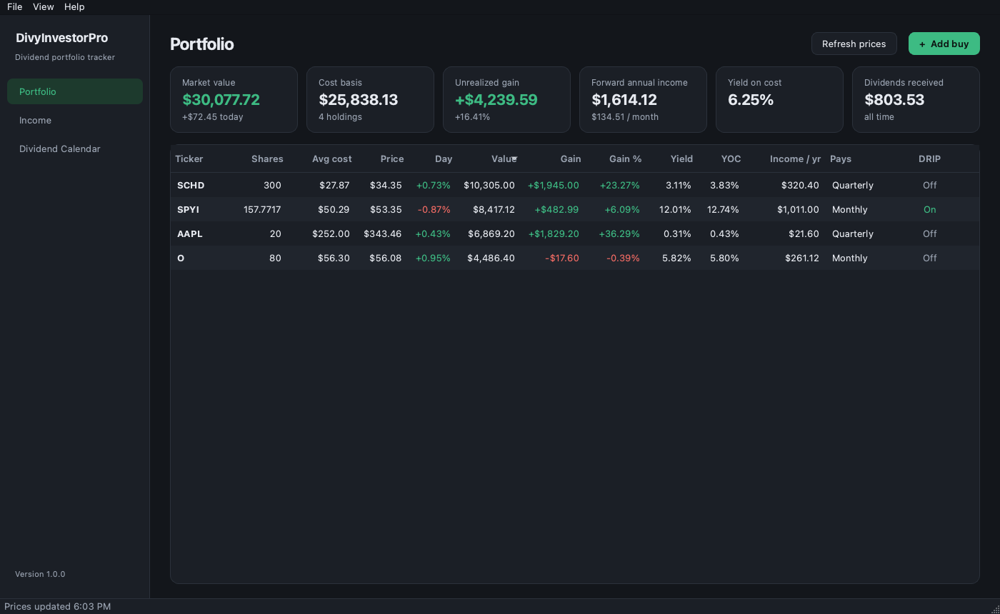
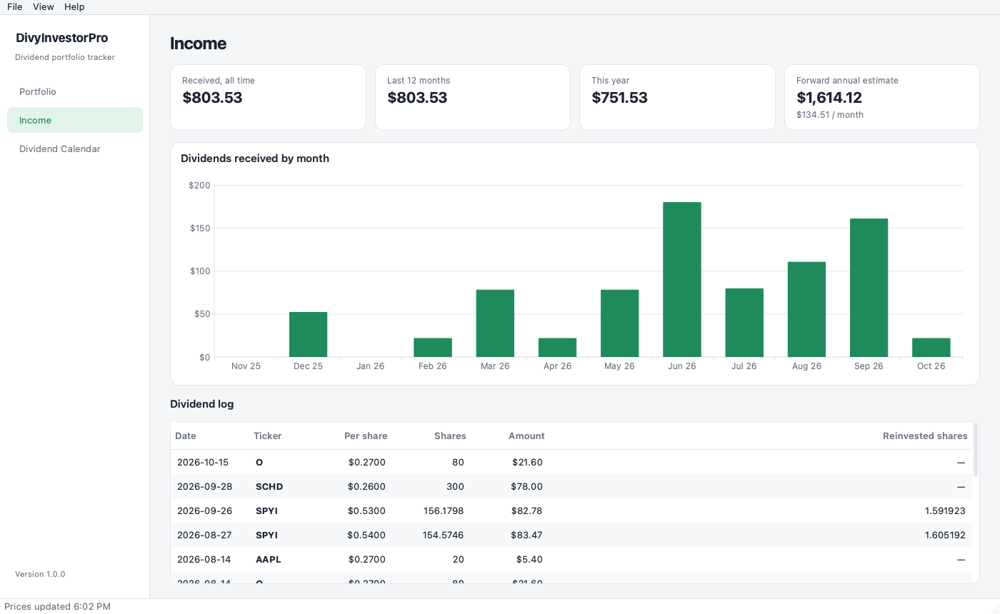
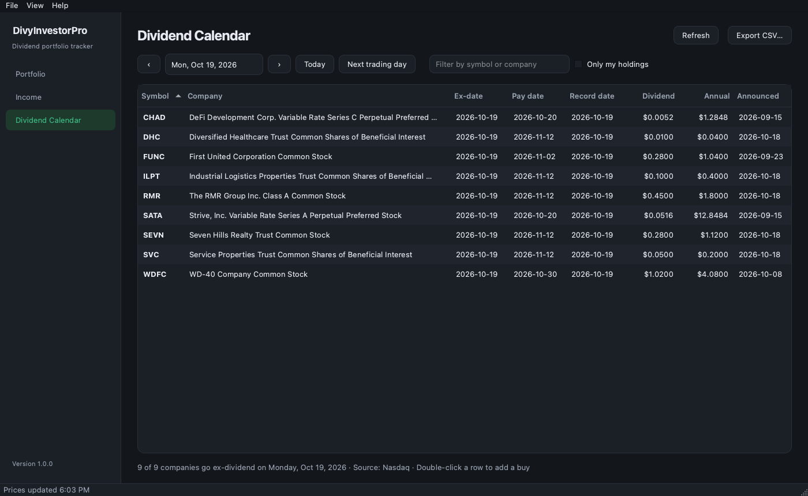
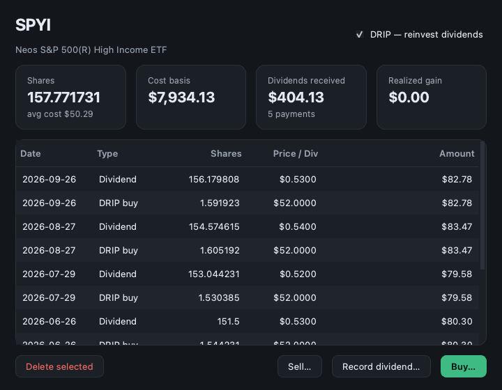

# DivyInvestorPro

A Mac desktop app for tracking a dividend portfolio, written in Python with PySide6 (Qt).
It follows the system light/dark appearance.



## Features

- **Portfolio**: holdings with shares, average cost, live price, day change, gain, yield,
  yield on cost, forward annual income and payout frequency. Double-click a holding (or
  right-click it) to buy, sell, record a dividend, toggle DRIP, or see its full history.
- **DRIP**: recording a dividend with "Reinvest" on also logs the reinvestment purchase,
  so shares and cost basis grow automatically.
- **Income**: dividends received by month (last 12 months), year-to-date, forward estimate,
  and a log of every payment.
- **Dividend Calendar**: every US stock and ETF going ex-dividend on a chosen day, with a
  market filter (All US, NYSE, Nasdaq, NYSE American, ETFs, Dow 30, S&P 500), text filter,
  "only my holdings", CSV export, and double-click to add a buy. Covering NYSE needs a free
  Massive API key (Settings); without one the calendar shows Nasdaq-listed stocks only.
- **Import / export**: File ▸ Import Portfolio… reads DivyInvestorPro files and
  FreedomTracker portfolio JSON files (holdings, buys, sells, dividends, DRIP).

| Income | Calendar | Holding |
|---|---|---|
|  |  |  |

## Data sources

- Prices and dividend history: Yahoo Finance chart API (via `curl_cffi`).
- Dividend calendar: [Massive](https://massive.com) (formerly Polygon.io) dividends API for all
  US exchanges, using your own free API key. Sign up, pick the free Basic plan, copy the key
  from the dashboard's API Keys page, and paste it into **Settings** in the app (or set the
  `MASSIVE_API_KEY` environment variable). The free plan allows 5 requests a minute; the app
  makes one per day you view and caches it for 10 minutes. Without a key the calendar falls
  back to Nasdaq's public calendar, which only lists Nasdaq-listed stocks.
- Exchange of each ticker: Nasdaq's public stock and ETF screener. S&P 500 members:
  Wikipedia. Both are cached for a week. The Dow 30 list is built in
  (`divyinvestorpro/reference.py`, as of June 29, 2026) and needs updating when the index changes.

Yahoo, Nasdaq and Wikipedia are unofficial, keyless sources; they can change or rate-limit
without notice.
Quotes are delayed. Not investment advice.

Your portfolio is saved to `~/Library/Application Support/DivyInvestorPro/portfolio.json`
after every change (File ▸ Show Data Folder). Settings, including your API key, are in
`settings.json` in the same folder, never in the project. Importing over an existing portfolio saves a
timestamped backup there first.

## Develop

```bash
python3 -m venv .venv
.venv/bin/pip install -r requirements.txt
.venv/bin/python run.py
.venv/bin/python -m unittest discover tests
```

## Build the Mac app

```bash
./build_mac.sh
```

Produces `dist/DivyInvestorPro.app` and `dist/DivyInvestorPro-<version>-Mac.dmg`. The app is
ad-hoc signed (no Apple Developer ID), so the first time you open it macOS will block it:
right-click the app ▸ Open, or allow it in System Settings ▸ Privacy & Security. The build
is for the Mac architecture it was built on (Apple Silicon here).

Bump the version in `divyinvestorpro/__init__.py`.

## Build the Windows exe

PyInstaller can't cross-compile, so the Windows build runs on Windows. The easy way is
GitHub Actions: **Actions ▸ Build Windows exe ▸ Run workflow** produces
`DivyInvestorPro.exe` as a downloadable artifact (and attaches it to a release if you give
a tag). Pushing a `v*` tag runs it too.

On a Windows PC, from the project folder in PowerShell:

```powershell
py -3.13 -m venv .venv
.venv\Scripts\pip install -r requirements.txt pillow
.\build_windows.ps1
```

Produces a single-file `dist\DivyInvestorPro.exe` (no install needed). It isn't code-signed,
so Windows SmartScreen shows "Windows protected your PC" the first time: click
**More info ▸ Run anyway**. On Windows the portfolio is saved in
`%APPDATA%\DivyInvestorPro\portfolio.json`.

## Layout

```
divyinvestorpro/
  portfolio.py   data model, average-cost math, JSON storage (no UI)
  market.py      Yahoo quotes/dividends, Massive and Nasdaq calendars (no UI)
  reference.py   ticker -> exchange, S&P 500 / Dow 30 membership (cached)
  calendar_data.py  builds and filters Dividend Calendar rows
  settings.py    settings.json (Massive API key)
  state.py       shared app state: portfolio + latest quotes
  app.py         main window, menus, entry point
  pages.py       Portfolio and Income pages
  calendar_page.py  Dividend Calendar page
  dialogs.py     Buy/Sell, Record dividend, Holding details, Settings
  widgets.py     table model, stat cards, formatting
  theme.py       light/dark colors and stylesheet
  icon.py        app icon drawn in code
  workers.py     background network calls
tests/           unit tests for portfolio math, quote estimates and calendar rows
tools/           icon export used by the build
dividend_calendar.py  the earlier standalone Tkinter calendar (superseded)
```
